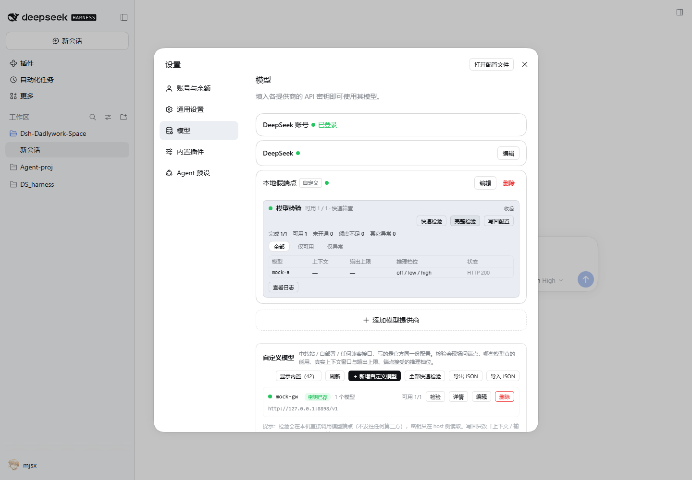
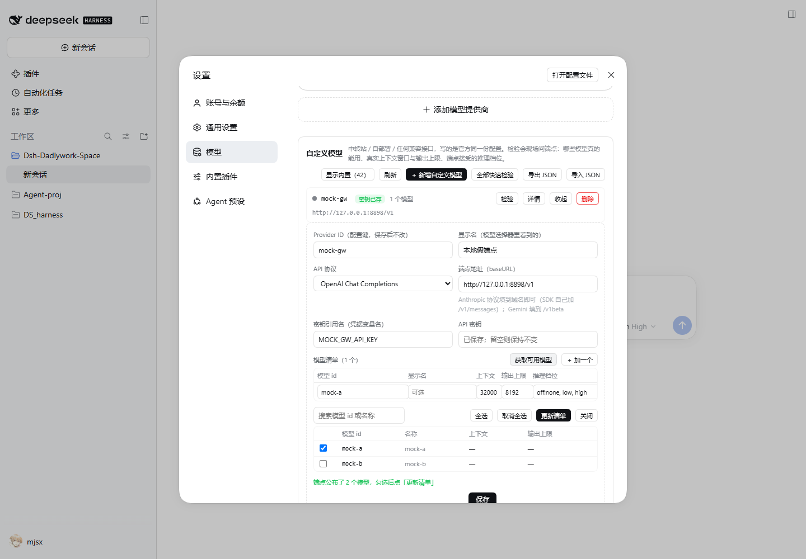

# dsh-custom-model · Custom Models

Adds two things to the DeepSeek Harness **Models** settings page: one place to manage custom model providers, and a probe that asks an endpoint what it actually serves. No theme, no patched official code — it only uses the two extension seats the Models page declares for out-of-tree plugins.



## What it solves

The official page can add a custom model API, one card at a time. What it cannot do:

1. **No overview** — routes live inside individual cards, so backups, migrations and bulk creation are manual.
2. **No liveness** — a provider's model list does not distinguish usable models from `product not activated`, exhausted quota, non-chat models, or plain rejections.
3. **Hand-written numbers rot** — context window, max output and reasoning levels are typed by hand; too small wastes capability, too large fails at request time.

## Features

### Custom-model console (`settings.models.footer` seat)

- One list of every hand-declared `llm-pi-ai` route: endpoint, model count, key state, last probe state
- Add / edit / delete routes (provider id, display name, protocol, baseURL, key reference + key, model list)
- **Fetch available models** — ask the endpoint, tick candidates, adopt them in one go
- **Export / import JSON** (endpoints and model lists only, never keys)
- **Show built-in (N)** lists the shipped providers too, so they can be probed from one place



### One-click capability fill

The official page asks you to type the context window, max output tokens and reasoning levels (level + API parameter value) by hand. The plugin asks the endpoint instead:

- **Auto-fill** on each provider row (and **Fill all** in the header)
- Costs **1–2 requests**: read the vendor catalog at `{origin}/api/v1/models` for every model's context window and output cap, then ask once which reasoning levels the endpoint enumerates
- Writes the results into the official fields, so the provider card then shows `Context window`, `Max output tokens` and `Reasoning levels` (level + API parameter value) already filled
- Without a readable catalog it degrades to per-model probing rather than writing guesses; anything the catalog does not disclose is left untouched

### Model probe (`settings.models.provider-card` seat)

Every custom provider card gains a probe panel that answers three questions the official page cannot:

| Question | How |
|---|---|
| Which models **actually answer** | One `max_tokens:1` request per model, classified as usable / not activated / quota exhausted / non-chat / rejected |
| **Real context window** and max output | Read the vendor catalog at `{origin}/api/v1/models` (one request covers every model); without a catalog, recover the output cap from the 400 reply to an oversized `max_tokens` |
| Reasoning levels the endpoint **accepts** | Probe each `reasoning_effort` level live; if the endpoint enumerates the legal set in a 400, one request is enough |

Two modes: **quick** (catalog + liveness, one request per model) and **full** (adds the output-cap fallback and per-level probing).
**Write back automatically** is on by default: as soon as a probe finishes, the measured `contextWindow` / `maxTokens` / `reasoningEfforts` go into that route's model list. Untick it to look without touching the configuration, or press **Write back** manually.

Probing runs in the **host half**: model endpoints send no CORS headers, and keys never reach the renderer. Progress is polled every second and can be cancelled.

## Install

```powershell
dsh plugin --profile desktop add https://github.com/sayzwx/dsh-custom-model

# or the prebuilt tarball from Releases
dsh plugin --profile desktop add https://github.com/sayzwx/dsh-custom-model/releases/download/v1.0.0/dsh-custom-model-1.0.0.tgz
```

Restart DeepSeek Harness afterwards (the host half mounts at startup), then open **Settings → Models**.

Uninstall:

```powershell
dsh plugin --profile desktop remove dsh-custom-model
```

## Where the data lives

- Providers: `llm-pi-ai.config.providers` in the profile's `cordis.patch.yml` — the *same* configuration the official page edits
- Keys: the official credential store (`ctx.credentials`); they never enter the renderer and are never echoed by any route
- The plugin keeps no state of its own: probe results are UI state, not facts

## Limitations

- **Write-back** only touches context window, max output and reasoning levels — never endpoints, keys, headers or retry policies
- **Built-in providers** draw their model list from the adapter catalog; writing back would copy that catalog into your configuration, so the plugin refuses and asks you to declare the model list first
- Probing sends chat requests only for OpenAI-compatible protocols (`openai-completions` / `openai-responses`); other protocols only get whatever the vendor catalog discloses
- The catalog is read from `{origin}/api/v1/models`; endpoints without one show context window as —
- Free models that need a local UA proxy (e.g. OpenCode Zen) are not handled
- Both the official page and this plugin write through `settings.mutate`, which is revision-checked: concurrent edits make the later writer report a conflict — reload and retry

## Compatibility

Built against **dsh 0.2.2-rc.5** (Electron 44.7.0 / Node 24.21.0 / Cordis 4.1.0), on documented seams only:

- host: `ctx.webServer.register`, `ctx.settings.describe/mutate`, `ctx.llm.listProviders/listConfigurableProviders/listModels/discoverModels`, `ctx.credentials.describe/set/unset/resolve`
- client: `ctx.slots.inject/register`, `settings.models.provider-card` (keyed, key = `llm-pi-ai`), `settings.models.footer` (list)

If a future harness changes those seams, the plugin logs a `[custom-model]` warning instead of blocking profile startup.

## Layout

```
lib/host.js        # 10 routes: state / provider.save / provider.remove / provider.enrich / models.discover / probe.*
lib/probe-core.js  # probe engine (taken from dsh-xingkong-theme v1.13.0, comments only)
lib/client.js      # React UI for both seats (window.__ModuleLoader__ lazy-CJS factory, no build step)
cordis.patch.yml   # inserts the host half into the profile tree
```

The browser half is a hand-written lazy-CJS bundle, so there is no bundler step: edit `lib/client.js` and reload the page;
editing `lib/host.js` needs an app restart.

## About this repository

This repository used to host **dsh-xingkong-theme** (a deep-space theme). The theme is retired; from v1.0.0 the repository ships this plugin instead (and its listing category moved from theme to model). Installed copies of the theme keep working, but receive no further updates.
