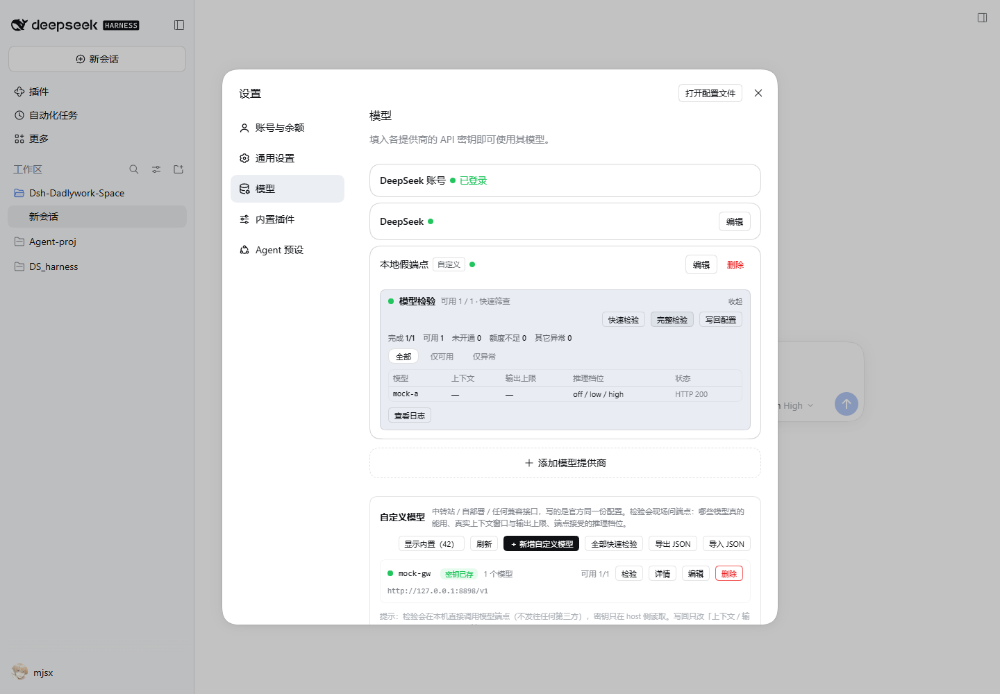
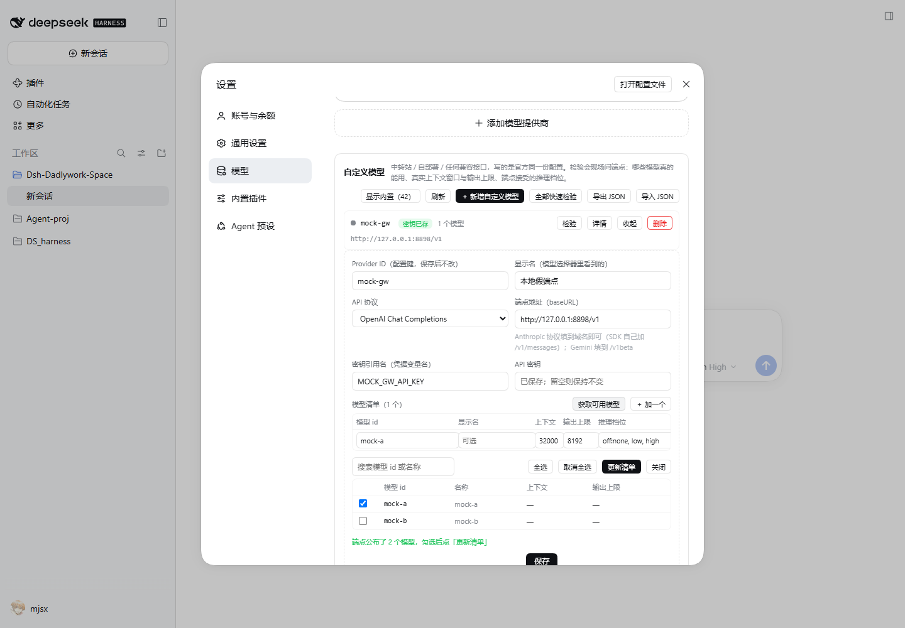
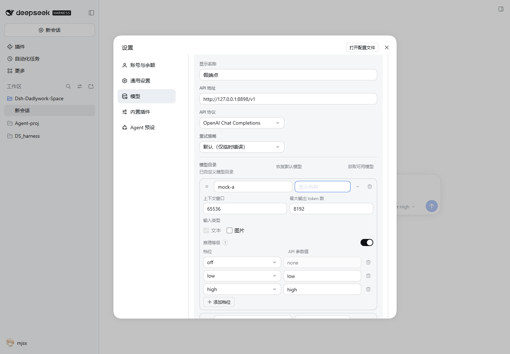

# dsh-custom-model · 自定义模型

给 DeepSeek Harness 官方「设置 → 模型」页补两块能力：**自定义模型的集中管理**，和**模型检验（探测）**。
不换主题、不改官方代码，只用官方为仓外插件预留的两个 UI 席位。



## 它解决什么

官方页能一条一条地添加「自定义模型 API」，但有三件事做不到：

1. **没有总览**：路由散在一张张卡片里，换机器、备份、批量建都只能手工重复。
2. **不知道模型是不是真的能用**：厂商列出来的清单不区分「可用 / 未开通 / 额度耗尽 / 非对话模型」。
3. **写死的数字迟早说谎**：上下文窗口、输出上限、推理档位都是手填的；厂商改一次，填小了浪费能力，填大了直接报错。

所以这个插件做两件事：把自定义路由收成一张表，能增删改、能导入导出；让探测引擎现场问端点，把答案写回配置。

## 功能

### 1) 自定义模型总览（`settings.models.footer` 席位）

- 一次列出所有 `llm-pi-ai` 手写路由：端点、模型数、密钥是否已存、上次检验状态
- 新增 / 编辑 / 删除路由（Provider ID、显示名、API 协议、baseURL、密钥引用 + 密钥、模型清单）
- **获取可用模型**：问端点要模型清单，勾选后「更新清单」批量带入（端点公布什么带什么）
- **导出 / 导入 JSON**（只含端点与模型清单，不含密钥）
- 「显示内置（N）」把内置提供商也列进来一起检验



### 2) 自动补全能力值（一条命令填满官方输入框）

官方页要你手填「上下文窗口 / 最大输出 token 数 / 推理等级（档位 + API 参数值）」。插件直接问端点要：

- 每条提供商行上的 **自动补全**（总览头部还有 **全部自动补全**）
- 只花 **1~2 次请求**：读厂商目录 `{origin}/api/v1/models` 拿到全部模型的上下文窗口与输出上限；再问一次端点的推理档位枚举
- 把结果按官方字段写进配置 —— 回到官方卡片里，`上下文窗口`、`最大输出 token 数`、`推理等级` 的档位与 API 参数值都已经填好
- 端点没有可读目录时，自动降级成逐个模型实测（宁可多花几次请求，也不写猜的数字）；目录里没有的字段一律不写



### 3) 模型检验（`settings.models.provider-card` 席位）

每张自定义提供商卡片里多一条「模型检验」，问端点三件事：

| 问题 | 做法 |
|---|---|
| 哪些模型**真的能用** | 每个模型发一次 `max_tokens:1` 的最小请求，区分「可用 / 未开通 / 额度耗尽 / 非对话模型 / 被拒绝」 |
| **真实上下文窗口**与输出上限 | 先读厂商目录 `{origin}/api/v1/models`（一次覆盖全部模型）；没有目录时用「超界 max_tokens」从 400 报文里读输出上限 |
| 端点**真正接受**的推理档位 | 逐档实测 `reasoning_effort`；端点若在 400 里列出合法集合，一次请求就能拿到全集 |

> 只想「把能力值补齐」而不关心存活状态时，用上一节的**自动补全**，它跳过逐个模型的存活请求。

两种模式：**快速检验**（目录 + 存活，每模型 1 请求）与**完整检验**（再加输出上限兜底与逐档探测）。
面板里默认勾选**检验后自动写入配置**：检验一结束就把实测的 `contextWindow` / `maxTokens` / `reasoningEfforts` 写回去，
不用再点第二次；想只看不动配置时取消勾选即可（也可以手动点**写回配置**）。

探测跑在 **host 半身**：模型端点没有 CORS 头，密钥也只该在 Node 侧读。进度 1s 轮询，可随时停止。

## 安装

```powershell
# 从源码目录装
dsh plugin --profile desktop add https://github.com/sayzwx/dsh-custom-model

# 或用 Release 里预构建的 tgz
dsh plugin --profile desktop add https://github.com/sayzwx/dsh-custom-model/releases/download/v1.0.0/dsh-custom-model-1.0.0.tgz

# 本地克隆后用路径
dsh plugin --profile desktop add file:D:/path/to/dsh-custom-model
```

装完**重启 DeepSeek Harness**（host 半身在启动时挂载），打开「设置 → 模型」。

卸载：

```powershell
dsh plugin --profile desktop remove dsh-custom-model
```

## 数据落在哪

- 提供商：profile 的 `cordis.patch.yml` 里 `llm-pi-ai.config.providers` —— 与官方页**同一份**配置，两边改动互相可见
- 密钥：官方凭据库（`ctx.credentials`），**永远不进渲染进程**，也不在任何接口响应里回显
- 插件自己不落任何状态文件：检验结果是内存里的 UI 状态，不是事实

## 已知边界

- **写回**只改「上下文 / 输出上限 / 推理档位」，不动端点、密钥、headers、retryPolicy
- **内置提供商**的模型清单来自适配器目录，写回会先把清单整份复制进用户配置，所以这时插件会拒绝写回并提示先手工声明模型
- 探测只对 OpenAI 兼容协议（`openai-completions` / `openai-responses`）发 chat 请求；其它协议只回填厂商目录里已有的信息
- 「厂商目录」读的是 `{origin}/api/v1/models`（阿里云百炼/多数中转站口径）。端点没有这个目录时，上下文窗口显示为 —
- 不处理需要本地 UA 代理的免费模型（例如 OpenCode Zen）
- 官方页与插件的写入都经过 `settings.mutate` 的 revision 检查：两边同时改，后写的一方会收到「冲突」，重新读一次即可

## 兼容性

针对 **dsh 0.2.2-rc.5**（Electron 44.7.0 / Node 24.21.0 / Cordis 4.1.0）。用到的都是官方文档化的接缝：

- host：`ctx.webServer.register`、`ctx.settings.describe/mutate`、`ctx.llm.listProviders/listConfigurableProviders/listModels/discoverModels`、`ctx.credentials.describe/set/unset/resolve`
- client：`ctx.slots.inject/register`、`settings.models.provider-card`（keyed，key = `llm-pi-ai`）、`settings.models.footer`（list）

harness 升级后若这些接缝变动，插件会在启动日志里给出 `[custom-model]` 前缀的告警，而不会拦住 profile 启动。

## 结构

```
lib/host.js        # 10 条 HTTP 路由：state / provider.save / provider.remove / provider.enrich / models.discover / probe.*
lib/probe-core.js  # 探测引擎（取自 dsh-xingkong-theme v1.13.0，只改注释）
lib/client.js      # 两个席位的 React UI（window.__ModuleLoader__ lazy-CJS factory，无构建步骤）
cordis.patch.yml   # 把 host 半身 insert 进 profile 的配置树
```

浏览器半身是手写的 lazy-CJS bundle，不需要 tsdown：改 `lib/client.js` 存盘刷新页面即生效，
改 `lib/host.js` 需重启应用。

## 关于这个仓库

本仓库原为 **dsh-xingkong-theme（星空主题）**。主题已停止维护，从 v1.0.0 起改为本插件（分类也从「主题」改为「模型」）。
仍在使用旧主题的用户：已安装的版本可以继续跑，但不会再有更新。
